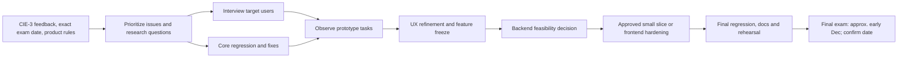

# CIE-3 and Final Exam Development Roadmap

**Today’s CIE-3 checkpoint:** 3 November 2026.
**Next final exam:** approximately one month after CIE-3, expected around early December 2026. Exact date/time is not known.
**Plan window:** remaining development begins 4 November and targets readiness by the end of the fourth week / early December. Keep the final rehearsal and deliverables ready at least one day before the confirmed exam date. Work ownership is divided between Deep and Yuvrat in TEAM_ALLOCATION.md.

## Today: CIE-3 checklist (3 November)

- Present the existing browser prototype honestly as a local front-end demonstration.
- Prioritize rubric evidence: problem hypothesis and evidence gap; current working flows and limits; named team members and their divided responsibilities; next-stage milestones, owners, tests and risks.
- Use the live order → My Orders → Partner Hub status demonstration if the browser is ready; otherwise use the documented screenshots/flow and explain the limitation.
- State clearly that customer validation has not yet been collected and demo testimonials are not research evidence.
- Record evaluator feedback, requested changes and any new final-exam expectations immediately after the session.

## Milestone tracker

| Milestone | Tasks | Owner | Timeline | Deliverable | Success Criteria |
|---|---|---|---|---|---|
| M0 — CIE-3 presentation and feedback capture | Present project, live/demo flow, truthful evidence status, team ownership and next plan; log evaluator comments and final requirements. | Deep (prototype/demo); Yuvrat (research/presentation notes); both handle Q&A | 3 Nov 2026 | CIE-3 feedback/action log | All four rubric areas addressed; no simulated feature or uncollected research presented as fact. |
| M1 — Rebaseline and user evidence | Convert evaluator feedback to prioritized issues; confirm product pricing/tax rules; recruit and interview target users/operators. | Yuvrat leads research and requirements; Deep supports prototype observations | 4–12 Nov | Feedback log, rules decision log and dated interview summary | Interview count and limitations reported honestly; target 5 customers and 3 operators if recruitment permits. |
| M2 — Core prototype reliability | Run regression checklist; fix highest-severity checkout, stock, reservation, catering and sign-in issues; confirm stored state behavior. | Deep implements; Yuvrat tests and records defects | 8–16 Nov | Stable demo build and regression report | Critical path cases pass in the agreed browser, or blockers and workarounds are documented. |
| M3 — Evidence-led UX refinement | Observe users completing ordering and status tasks; implement up to three highest-value observed improvements; check keyboard and mobile layouts. | Yuvrat recruits/observes; Deep implements; both review | 13–21 Nov | Observation notes and refined prototype | Report actual task completion/time/errors; do not claim target success unless observed. |
| M4 — Final architecture and feature freeze | Decide whether final exam remains front-end prototype or can include one server-backed order slice; freeze scope and demo path. | Deep assesses technical feasibility; Yuvrat checks schedule, rubric and acceptance | 17–23 Nov | Architecture decision record and frozen feature list | Backend proceeds only if hosting, security owner and time are confirmed; otherwise prioritize frontend reliability. |
| M5 — Final validation and presentation readiness | Complete regression, address blockers, finalize diagrams/docs/slides, rehearse and prepare screenshots/local fallback. | Yuvrat leads QA/documentation; Deep owns build/demo; both rehearse | 24 Nov–2 Dec | Final test report, presentation, demo checklist and backup | Clean-profile demo rehearsed; all claims trace to inspected code or collected evidence; each member explains owned tasks. |
| M6 — Final exam | Demonstrate final build, report evidence and explain limitations/future plan. | Deep and Yuvrat | Approx. early Dec 2026; exact date TBD | Final evaluation demonstration | Core flow completes or the backup is presented; all final deliverables are available locally. |

## Four-week schedule

| Week | Dates | Focus | Checkpoint |
|---|---|---|---|
| 1 | 4–10 Nov | Capture CIE-3 feedback; confirm rules; recruit participants; begin regression and fixes. | Scope, issue priority and owners agreed. |
| 2 | 11–17 Nov | Finish interviews; test core flows; close top defects; decide backend feasibility. | Evidence and architecture decision reviewed. |
| 3 | 18–24 Nov | Complete user observations and UX fixes; freeze features; begin final presentation assets. | Release candidate and acceptance criteria agreed. |
| 4 | 25 Nov–2 Dec | Regression, defect closure, documentation, slide polishing and repeated demo rehearsal. | Final readiness sign-off by 2 Dec. |
| Exam | Approx. early Dec | Final demonstration and evaluation (exact date to confirm). | Deliver build and evidence; use fallback if live demo fails. |

## Dependencies

## Resources and risk plan

**Resources:** current computers/browser, repository, Python 3 static server, synthetic test data, participant time/consent and test log. A backend slice also needs confirmed hosting, database, HTTPS, secrets handling, access controls and an implementation/review owner. None is presently established.

| Risk | Mitigation / trigger |
|---|---|
| Final exam date is earlier/later than estimated | Confirm with faculty when available; move the readiness deadline to at least one day before the actual exam. |
| Customer recruitment is limited | Start in week 1; report actual sample and limitations; do not fabricate validation. |
| Team role proposal does not match skills/time | Deep and Yuvrat confirm or exchange assignments by 5 Nov; keep one accountable owner per task. |
| Backend exceeds capacity | Gate at M4; drop it if hosting/security ownership is unclear; retain local demo fallback. |
| Changes break the live demo | Use regression checklist and clean browser profile; freeze features by 23 Nov. |
| External images/fonts/network fail | Keep local screenshots and rehearse local serving; state image/CDN limitation. |
| Price/tax assumptions are wrong | Confirm with sponsor/accounting guidance; label estimates until verified. |
| Demo localStorage is mistaken for production security | Use synthetic information and state local-only, same-browser boundary in presentation. |

## Expected outcome by the final exam (about four weeks)

A reproducible and accurately described prototype; a dated record of evaluator feedback; user evidence if recruitment succeeds; tested critical flows with known defects disclosed; divided contribution ownership; and a justified next-stage architecture. A production service is not promised unless the separately gated backend work is actually completed and verified.
