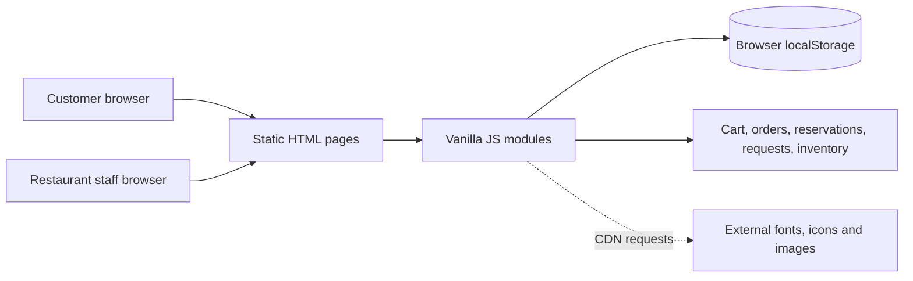

# Project Audit — King of Spices Revenue Platform

**Audit date:** 3 November 2026
**Scope:** repository files, source, configuration, documentation and Git metadata. No customer research, team roster or test dataset was present.

## Executive finding

The repository is an existing static HTML/CSS/JavaScript prototype extending the King of Spices restaurant site. It demonstrates a broad set of local customer and restaurant workflows, but it is not a deployable revenue system: all state is browser-local and authentication, payment, billing, messaging and cross-user coordination are simulated or absent. Its strongest CIE-3 evidence is breadth of working front-end flows; its largest gaps are customer validation, named contribution evidence and a tested path beyond the prototype.

## Repository and stack

- `king-of-spices/`: nine full HTML pages, one stylesheet, five JavaScript files and a favicon; no package manifest, server, API, database, automated test suite, hardware or dataset.
- Stack: semantic HTML, vanilla CSS and browser JavaScript; `localStorage` for cart, orders, membership, reservations, catering requests and inventory. Font Awesome and food images load from external URLs.
- Git at the initial audit: one visible commit (`f3bee52`, initial commit), so prior individual contributions were not distinguishable. On 3 November, the CIE-3 preparation and prototype changes were committed as `4512542` under the repository's configured author; its message notes AI assistance. No Yuvrat-authored commit is visible. Root `PROJECT_DOCUMENTATION.md` was untracked at audit time.

## Feature status from source inspection

| Feature | Status | Evidence / boundary |
|---|---|---|
| Menu/cart and quantity controls | Implemented in prototype | `index.html`, `assets/js/script.js`; local state and fixed menu data. |
| Cart totals, coupons, delivery and estimated tax | Implemented as simulation | Rules are hard-coded; amounts and tax treatment need business/accounting confirmation. |
| Checkout/order creation and stock deduction | Implemented locally | Creates `kos_orders` and decrements local inventory. No payment or fulfillment service. |
| Customer order history/status view | Implemented locally | `my-orders.html`, `assets/js/dashboard.js`; status reflects manual local edits, not live delivery tracking. |
| Kitchen queue and inventory editor | Implemented locally through `partner-portal.html` | Same-browser local state; no staff authorization or concurrency control. |
| Standalone restaurant/inventory/user dashboards | Redirect placeholders | `dashboard-restaurant.html`, `dashboard-inventory.html`, `dashboard-user.html` redirect to combined partner hub or My Orders. |
| King's Club | Join/cancel and discount state | No recurring billing, entitlement service or verified member identity. |
| Catering | Estimate, validation and reference record | Request is saved locally; no actual staff notification or quote workflow. |
| Reservation | Form validation and confirmation record | Saved locally; no availability checking or booking confirmation service. |
| Partner onboarding | Form/portal UI | No backend review, partner account creation or commission settlement. |

## Verified improvements made in this audit

- Checkout now requires a 10-digit phone number, matching the form's stated Indian phone format.
- Reservation and catering date inputs now disallow dates before the browser's local current date.
- Adding a dish with a name that normalizes to an existing inventory ID now stops with a message instead of replacing the existing record.
- The sign-in modal now has a branded responsive layout, clearer role selection and focus states; saved customer values are populated as form values rather than inserted into HTML markup.

## Gaps, risks and opportunities

1. **Evidence:** no interviews, survey results, observation notes or credible customer research are included. Testimonials in the website are not research evidence and must not be represented as such.
2. **Security/data:** demo role selection and staff PIN are client-side; local storage is editable and not private. Do not put real customer, payment or staff data in this prototype.
3. **Reliability:** there is no backend validation, atomic stock/order update, recovery, backup, audit trail or multi-device synchronization.
4. **Product accuracy:** an earlier supplied guide disagreed with the in-page catering prices. The current canonical README avoids quoting package rates; confirm the displayed prices, tax and fees with the project sponsor before treating them as business rules. Order status is changed manually; no automatic progression exists.
5. **External dependency:** artwork/icons rely on third-party URLs/CDNs and may fail offline. No image assets or diagrams are bundled beyond the favicon.
6. **Usability/accessibility:** validate keyboard, mobile, screen-reader, contrast and form error behavior. External fonts/icons can affect rendering.
7. **Engineering:** no automated regression, linting or build pipeline exists. Dynamic HTML includes values from local state; harden output escaping before any real user data or backend integration.

## Architecture at a glance

Customer and staff are labels for flows in the same browser origin/profile. There is no network service between separate users.

## Recommended order of work

1. Confirm the customer segment and interview actual restaurant customers/operators; capture consented, dated evidence.
2. Resolve product rules: actual menu/package prices, delivery assumptions, tax/accounting treatment and membership terms.
3. Run the manual regression cases in `TESTING_REPORT.md`; record dated outcomes and screenshots with synthetic data.
4. Decide scope for CIE-3: keep this as an honest front-end demonstrator or build a small server-backed MVP with authentication, database, role checks and payment sandbox.
5. Assign named owners and due dates from `DEVELOPMENT_ROADMAP.md`; replace all confirmation markers with team-approved facts.
