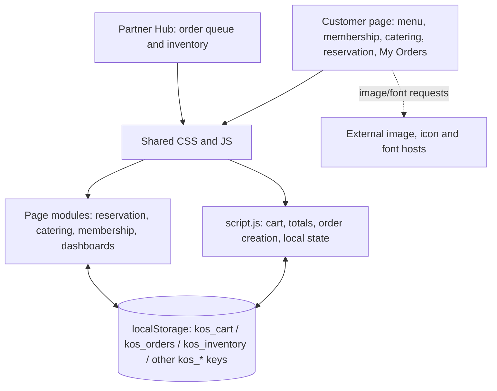
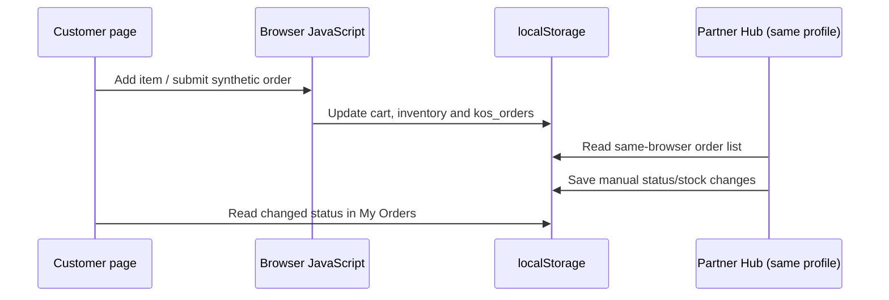

# Technical Architecture

## Current prototype

The repository serves static HTML pages. Each page loads shared CSS and browser JavaScript. `script.js` owns common navigation, cart, checkout and local state helpers; `reservation.js`, `catering.js`, `kings-club.js` and `dashboard.js` attach page-specific behavior. State is serialized into `localStorage` under `kos_*` keys. `partner-portal.html` hosts kitchen and inventory tabs; `my-orders.html` renders customer order history. Standalone dashboard files redirect to these consolidated pages.

This model has no server-side trust boundary. Separate devices/users do not share state. Client-side role selection is a demo affordance, not access control. Local storage is not a secure customer database.

## Current data flows

## Production direction (proposed, not implemented)

If the project advances beyond a single-browser demo, introduce a same-origin or HTTPS API with validated request schemas, relational persistence and server-controlled authorization. Core entities: users/roles, menu items, inventory movements, orders/order items/status events, membership entitlements, reservations and catering inquiries. Use server-side transactions for order placement/stock reservation; an order status event log; role checks for staff actions; data minimization and retention rules; operational logs; backups; rate limits; and tested recovery. Integrate payments through a provider sandbox with signed webhook verification only after cancellation/refund flows are designed.

Suggested sequence: (1) agree requirements and data model, (2) implement order create/read/status vertical slice, (3) enforce customer/staff authorization, (4) test multi-session and concurrency, (5) add payment sandbox if approved. Select language/hosting only after team skills, cost and institutional constraints are confirmed.

## Key design constraints

- Avoid storing real addresses, phones, credentials or payment details in the demo.
- Escape user-controlled strings before rendering; do not trust local storage.
- Persisted order state, stock changes and money calculations must become server-authoritative before real use.
- Confirm whether tax is applicable and whether its base includes delivery/discounts; current 5% calculation is only a prototype assumption.
- Replace third-party assets with licensed/local assets if offline or reliable demonstration is required.
